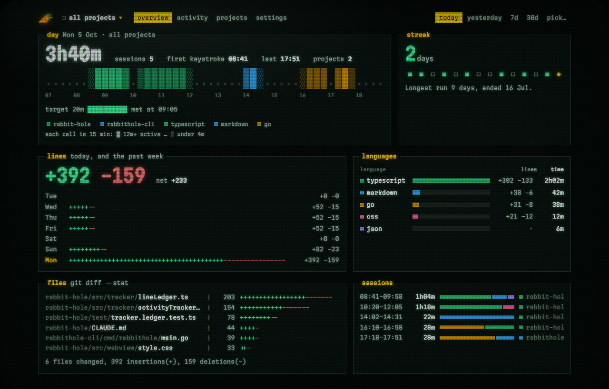
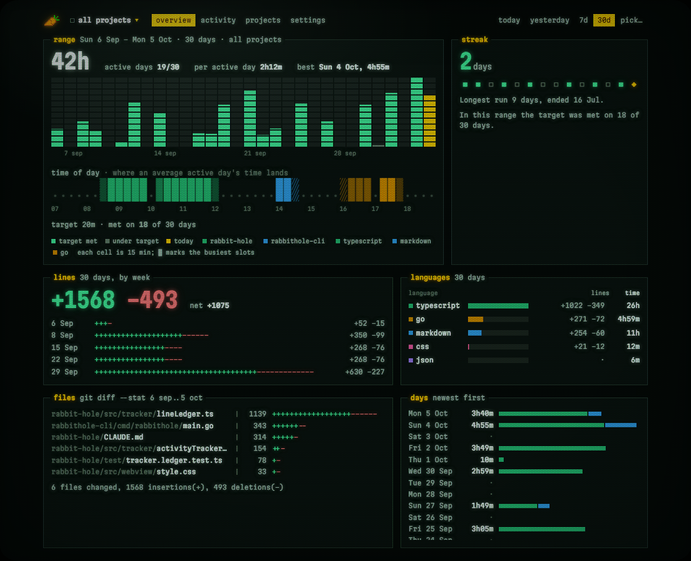
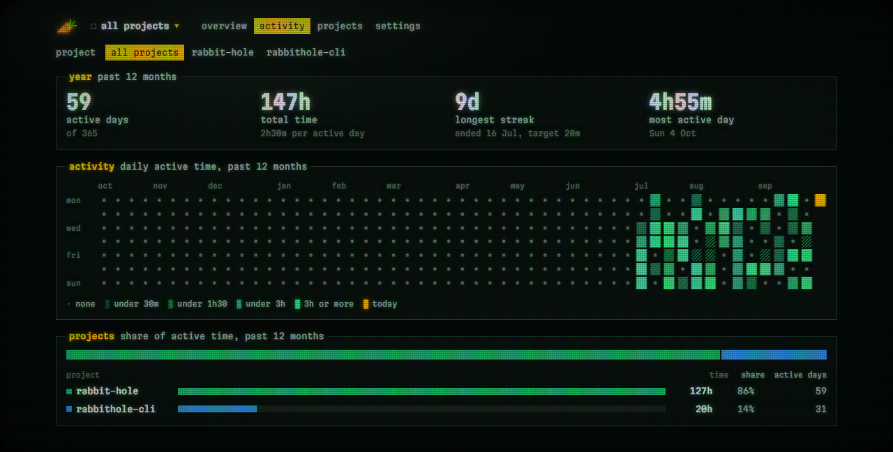
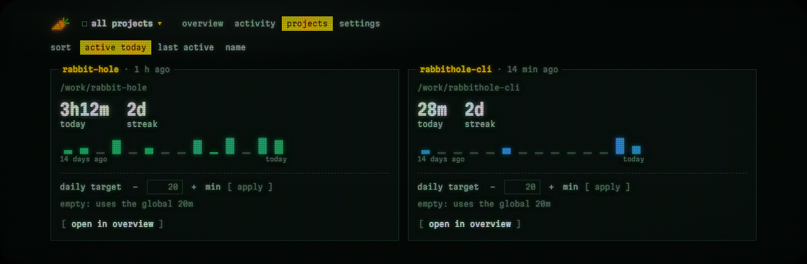
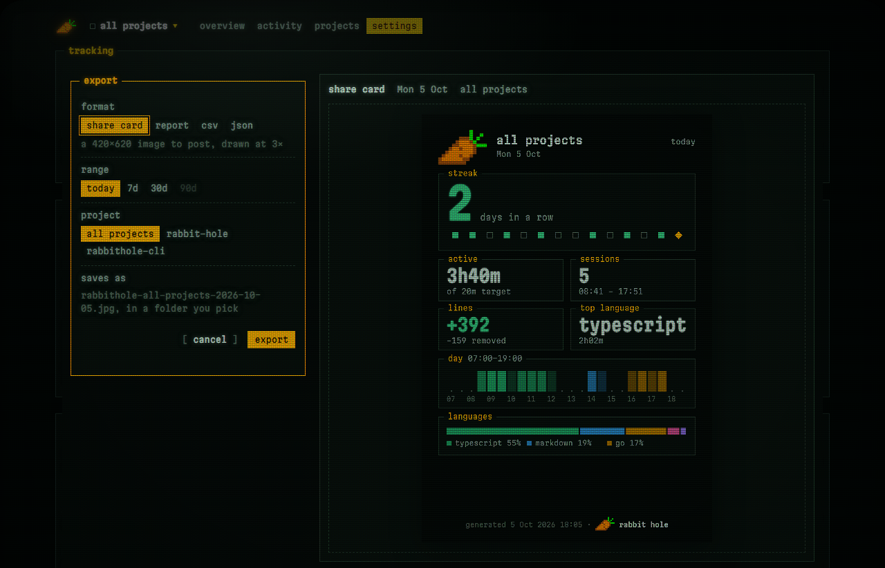
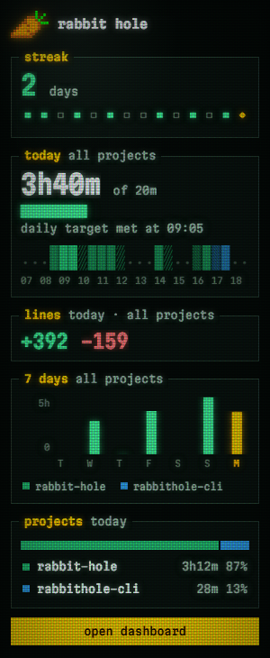

# Rabbit Hole

Automatic coding-activity tracking for VS Code, with an in-editor dashboard.

Everything is local. No account, no backend, no telemetry — your data lives in VS Code's
storage on your machine and never leaves it.



---

## What it does

Rabbit Hole runs quietly in the background and records what you actually worked on:

- **Active time, not elapsed time.** Idle gaps are excluded. Step away for five minutes and
  the clock pauses; come back within an hour and the same session resumes.
- **Lines added and deleted**, per file and per language, counted the way `git diff`
  would against each file's content at the start of the day.
- **Language breakdown**, by time and by lines.
- **Per-project history**, detected automatically from your git remote (or the folder, for
  non-git projects). Projects are tracked separately and can be viewed together.
- **Daily streaks** against a target you choose.

### It sees your AI agent's work

Most time trackers only observe the editor, so work done by a coding agent is invisible to
them. Rabbit Hole also watches the workspace on disk, so edits made by Claude Code, Codex,
Aider or any CLI tool are counted — including to files you never opened.

- **Lines are net per file per day.** An agent rewriting the same function ten times counts
  once; a temporary file created and deleted counts nothing; lines written and removed the
  same day cancel out. Branch switches, merges, rebases and worktree churn are recognised
  and not recorded as work.
- **Language time follows the agent.** While you watch an agent in the terminal, your time
  goes to the languages of the files it edits, not to whichever tab happened to be open —
  even with no file open at all. If nothing is edited, the time still counts towards your
  day, just without a language.
- **Nothing is lost to a restart.** Each file's first edit of the day is measured from its
  content at midnight — from git, or from the snapshot kept of the day before — so in a
  git repository, edits made earlier today while VS Code was closed are counted when it
  opens.

---

## The dashboard

Open it from the status bar, or run **Rabbit Hole: Open Dashboard** from the command
palette. Pick a project or all of them, and today, yesterday, the last 7 or 30 days, or any
day or range from the calendar.

| Tab | Shows |
|-----|-------|
| **Overview** | Active time and sessions, the day on a 15-minute tape, the target meter, the streak, lines per day, languages, files changed and sessions. A range shows a column per day and where an average day's time lands. |
| **Activity** | The past 12 months: active days, total time, longest streak, most active day, a heatmap, and each project's share. |
| **Projects** | One card per project: today, its streak, the last 14 days, and its own daily target. |
| **Settings** | Daily target, idle threshold, the CRT display, your data, and export. |

Hover a project or language anywhere on the overview to narrow every panel to it.







### Export

From **Settings → export…**:

| Format | What you get | Ranges |
|--------|--------------|--------|
| **Share card** | A 420×620 image (JPEG, drawn at 3×) to post | today, 7 or 30 days |
| **Report** | An A4 PDF to keep or print | today, 7, 30 or 90 days |
| **CSV** | One row per day | today, 7, 30 or 90 days |
| **JSON** | The daily logs in full | today, 7, 30 or 90 days |

Any of them for all projects or just one.



### The sidebar and the status bar



The carrot in the Activity Bar opens a compact view of today: the streak, time against
your target, the day's tape, lines changed, the last seven days and today's projects.
Hovering a project narrows it to that project.

The status bar shows today's active time against your target, and opens the dashboard
when clicked.

The dashboard and sidebar are drawn as a phosphor terminal, with an optional CRT mask,
scanlines and bloom. All of it follows your VS Code theme, light and high contrast
included, and every effect can be turned down or off in **Settings → display**.

<br clear="right">

---

## Your data

Everything is stored locally by VS Code. The **Settings → Your data** section gives you
full control:

- **Back up everything** or **back up some projects** — a complete, restorable snapshot
  written to a folder you can open from the dashboard.
- **Restore everything** or **restore some projects** — bring history back after a mistaken
  delete, or move a project's history to another machine. Restoring specific projects
  leaves every other project untouched.
- **Clear a project's history** or **clear everything** — both gated by typing the exact
  name to confirm, and both write a backup first.

A JSON mirror of your data is also maintained on disk, so you can read it with your own
tools — or with the CLI below.

---

## Companion CLI

[**rabbithole-cli**](https://github.com/platinumfalcon98/rabbithole-cli) puts the same stats
in your terminal, for when you don't want to open a dashboard to answer "how long have I
been at this?".

```sh
brew install platinumfalcon98/tap/rabbithole      # macOS, Linux
scoop bucket add platinumfalcon98 https://github.com/platinumfalcon98/scoop-bucket
scoop install rabbithole                           # Windows
```

Prebuilt binaries for macOS, Linux and Windows on amd64 and arm64 are on the
[releases page](https://github.com/platinumfalcon98/rabbithole-cli/releases), along with
install scripts and a `go install` route.

| Command | Shows |
|---------|-------|
| `rabbithole today` | Today's active time, languages, projects, sessions |
| `rabbithole streak` | Current streak and progress toward your target |
| `rabbithole week [n]` | The last 7 days as a bar chart, or the last `n` |
| `rabbithole files [n]` | Files touched over that range, grouped by project |
| `rabbithole projects` | Tracked projects and their recent activity |
| `rabbithole doctor` | Check the data source for format drift |

`today` and `week` take `--project` to narrow to one project, and every command takes
`--json` for scripting:

```sh
rabbithole streak --json | jq -e '.targetMet' >/dev/null && echo "done for today"
```

The CLI **reads only** — it never writes to your data and never touches the network. It
reads the JSON mirror this extension publishes, falling back to VS Code's storage directly
for history that predates the mirror. It reports on what the extension has recorded; it
does not track anything itself, so the extension is what you need installed.

---

## Settings

| Setting | Default | What it does |
|---------|---------|--------------|
| `rabbithole.dailyTargetMinutes` | 20 | Daily active-coding target (1–1440). Days that reach it extend your streak. |
| `rabbithole.idleThresholdMinutes` | 5 | Minutes of inactivity before the active timer pauses (1–60). |
| `rabbithole.crt.mask` | `slot` | Phosphor mask: `slot`, `grille`, `shadow` or `off`. |
| `rabbithole.crt.pitch` | `fine` | Size of the mask's cells: `fine`, `medium` or `coarse`. |
| `rabbithole.crt.strength` | 23 | How strongly the mask darkens the screen (0–100). |
| `rabbithole.crt.vignette` | 35 | How much the glass darkens the screen's edges (0–100). |
| `rabbithole.crt.effects` | scanlines, bloom | Extra effects: scanlines, bloom, convergence, refresh roll, flicker. Roll and flicker are skipped when your system asks for reduced motion. |

Individual projects can override the daily target from the Projects tab; without an
override they inherit the global one.

Each day is judged against the target that was set **at the time**, so raising your target
later never erases a streak you already earned.

---

## Known limitations

- **In-editor AI suggestions are counted as your own typing.** Accepting a Copilot or
  Cursor completion looks identical to typing it — VS Code's change events carry no
  provenance. Attributing those is not currently possible and is not attempted.
- **Language time for in-editor agents** (Copilot agent mode, Cline, Continue) goes to the
  file you are in, not the files the agent edits. Only agents that write files to disk,
  such as terminal agents, are followed.
- **The active timer only sees VS Code.** Typing in the integrated terminal is not
  something VS Code reports, so if an agent works for longer than the idle threshold
  without changing a file, the timer pauses until something happens. Time spent in another
  window is not counted.
- **Multi-root workspaces can split attribution.** With several folders in one window, an
  agent editing project B while you are focused on project A records B's lines against B
  but A's time against A.
- **Line counts are very close, not exact.** They are computed from 32-bit line hashes,
  and a rare collision can hide a changed line. `.gitignore` is not used to exclude files,
  but build output, dependencies, lockfiles and minified files are.
- **History before 0.6.0 is not recounted.** Days recorded by earlier versions keep the
  line counts they were recorded with.

---

## Requirements

VS Code 1.85 or newer. Git is optional; with it, line counts survive restarts and branch
operations more precisely.

---

## Contributing

```bash
npm install
npm run build      # extension + webview
npm test           # 711 tests across 46 suites
npm run typecheck  # src and tests
```

Press <kbd>F5</kbd> to launch an Extension Development Host.

---

## License

MIT — see [LICENSE](LICENSE).
